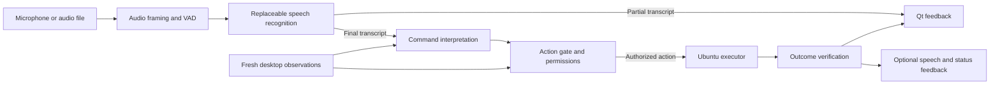

<p align="center">
  <picture>
    <source media="(prefers-reduced-motion: reduce)" srcset="assets/brand/hero-still.webp">
    
  </picture>
</p>

<h1 align="center">KYRIN</h1>
<p align="center">
  A voice assistant for Ubuntu GNOME that turns locally recognized speech
  into permission-checked desktop actions.<br>
  Built by <a href="https://github.com/mohammadhosseinzakeri10">Mohammad Hossein Zakeri</a> · Kailarin
</p>
<p align="center">
  <a href="https://github.com/mohammadhosseinzakeri10/kyrin/actions/workflows/quality.yml"></a>
  <a href="LICENSE">MIT license</a> · Python 3.14+ · Ubuntu 26.04 · GNOME Shell 50 · Alpha
</p>
<p align="center">
  <a href="#quick-start">Quick start</a> · <a href="docs/GETTING_STARTED.md">Setup guide</a> ·
  <a href="docs/architecture/OVERVIEW.md">Architecture</a> · <a href="SECURITY.md">Security</a> ·
  <a href="CONTRIBUTING.md">Contributing</a>
</p>

You say a command such as `Open Calculator`. KYRIN transcribes it with a
speech model running on your machine, interprets it, and acts on the desktop
only if you have granted that capability and the target can be identified.
It runs from source on Ubuntu with GNOME Shell 50, and its Qt control center
manages audio, models and permissions.

A fresh installation starts with the microphone off and desktop actions
disabled. KYRIN downloads no speech models; you choose and install one.
To try it, follow the [quick start](#quick-start).


*The Qt control center with default settings, before a speech model or
microphone is configured.*

## What you can do

- **Speak to it locally.** Use a microphone or an audio file with a
  whisper.cpp, Vosk or Omnilingual recognizer. You provide a compatible model
  and runtime for the engine you choose.
- **Open and arrange apps.** Launch or activate installed apps, then minimize,
  restore, maximize or close their windows. Window operations need the
  bundled GNOME Shell extension and a grant for each app.
- **Scroll and use named controls.** Scroll the active window or ask for a
  visible control by name, such as `Click Advanced`. Each action needs its own
  capability and prepared input access. Named controls also need fresh
  accessibility or OCR evidence and may ask you to confirm.
- **Navigate Telegram Desktop.** Open Saved Messages or select a chat after
  KYRIN verifies the Telegram window. Navigation never sends a message. It
  needs its own capability, and some paths need GNOME accessibility, screen
  access or OCR.
- **Try experimental window control.** Choose among windows of one app, close
  all windows of an app normally, and work with Ptyxis terminal tabs. Live
  coverage of these routes is still limited.
- **Get feedback your way.** Use an English or Persian interface, optional
  local speech output, and an optional on-screen status character provided
  by a separate GNOME extension.

Once recognition and the relevant permissions are set up, try these phrases:

| Say | What happens |
| --- | --- |
| `Start listening` | KYRIN leaves standby and accepts commands. |
| `Open Calculator` | Opens or activates Calculator, if desktop actions are enabled and the app is allowed. |
| `Minimize Calculator` | Minimizes its window, if window control is granted for the app. |
| `Stop listening` | KYRIN returns to standby. `Turn off microphone completely` stops capture. |

The [command guide](docs/commands/USER_COMMAND_GUIDE.md) lists every supported
phrase and its prerequisites.

## Quick start

You need:

- Ubuntu 26.04 with a GNOME Shell 50 Wayland session for desktop integration.
  Windows and macOS are not supported.
- Python 3.14 or later. GNOME portal and accessibility helpers also use the
  system `/usr/bin/python3`, which must be 3.14 or later.
- A local speech model for one supported engine. The control center opens
  without one.

Install the system libraries, then build and launch the control center from
source:

```bash
sudo apt-get update
sudo apt-get install -y libportaudio2 libegl1 libopengl0 ffmpeg speech-dispatcher
git clone --branch main https://github.com/mohammadhosseinzakeri10/kyrin.git
cd kyrin
python3.14 -m venv .venv
.venv/bin/python -m pip install -r requirements/bootstrap.txt
.venv/bin/python -m pip install -r requirements/core.txt -r requirements/test-ui.txt
.venv/bin/python -m pip install --no-build-isolation --no-deps -e .
.venv/bin/python -m pip check
.venv/bin/kyrin-desktop
```

Run it as your normal user, not as root. The first launch only opens the
control center. Continue with the [setup guide](docs/GETTING_STARTED.md):

1. [Configure speech input](docs/GETTING_STARTED.md#2-configure-speech-input):
   import a model and choose a microphone.
2. [Add desktop integration](docs/GETTING_STARTED.md#desktop-integration):
   install the GNOME extension and grant only the capabilities you need.
3. [Try example commands](docs/GETTING_STARTED.md#example-commands) and see
   [troubleshooting](docs/GETTING_STARTED.md#settings-shutdown-and-troubleshooting).

## How it works



- **Interpretation proposes; the action gate decides.** Deterministic rules
  or an optional local Ollama model turn a transcript into a proposed action.
  The action gate then checks the saved capability, the target's identity and
  the operation's deadline before anything runs.
- **Permissions are layered.** App selection, per-capability grants and
  GNOME's own consent prompts are separate, and each can be revoked.
  See [persistent permissions](docs/actions/PERSISTENT_PERMISSIONS.md).
- **Dispatch is not success.** KYRIN distinguishes a verified result from
  input that was only delivered. These checks reduce but do not eliminate
  the effect of misrecognized speech.

Read the [architecture overview](docs/architecture/OVERVIEW.md),
[control policy](docs/actions/CONTROL_POLICY.md) and
[trust boundaries](SECURITY.md#trust-boundaries) for the details.

## Project status

KYRIN is an open-source alpha. Public `main` carries the current reviewed
source, and changes since the
[v0.1.0 pre-release](https://github.com/mohammadhosseinzakeri10/kyrin/releases/tag/v0.1.0)
are unreleased. There is no portable installer. Automated checks run headless
with test doubles; live checks cover selected scenarios on one Ubuntu desktop.
See [validation and known limits](docs/VALIDATION.md), the
[roadmap](docs/ROADMAP.md) and the [release policy](docs/RELEASE_POLICY.md).

## Documentation

- [Setup guide](docs/GETTING_STARTED.md): installation, models, desktop integration
- [Command guide](docs/commands/USER_COMMAND_GUIDE.md): supported phrases and conditions
- [Architecture overview](docs/architecture/OVERVIEW.md) and [source map](docs/development/PROJECT_LAYOUT.md)
- [Security policy](SECURITY.md): trust boundaries and private reporting
- [Validation](docs/VALIDATION.md), [roadmap](docs/ROADMAP.md) and [changelog](CHANGELOG.md)
- [Documentation index](docs/README.md): current guides and historical notes

## Development and tests

The quality gate runs syntax checks, Ruff, strict mypy and the deterministic
pytest suite, the same checks used in CI. After the quick start install:

```bash
.venv/bin/python -m pip install -r requirements/dev.txt
PYTHONPATH="$PWD/src" .venv/bin/python scripts/development/check.py
```

The full suite needs extra Ubuntu packages listed in
[Contributing](CONTRIBUTING.md#development-setup), which also covers the review
expectations for changes. Use [issues](https://github.com/mohammadhosseinzakeri10/kyrin/issues)
for reproducible bug reports and follow the [code of conduct](CODE_OF_CONDUCT.md).
Report vulnerabilities privately as described in [SECURITY.md](SECURITY.md).

## License

KYRIN is distributed under the [MIT License](LICENSE). The bundled Silero VAD
model keeps its own MIT notice; see [third-party notices](THIRD_PARTY_NOTICES.md)
for dependencies and separately acquired models. The project was developed with
AI assistance under maintainer direction.
