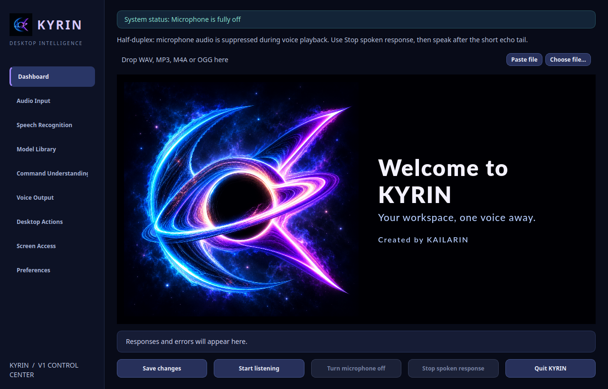
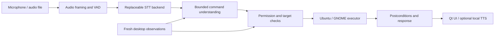

<p align="center">
  <picture>
    <source media="(prefers-reduced-motion: reduce)" srcset="assets/brand/hero-still.webp">
    
  </picture>
</p>

<h1 align="center">KYRIN</h1>
<p align="center">
  A local-first voice desktop agent with permission-gated actions.<br>
  Built by <a href="https://github.com/mohammadhosseinzakeri10">Mohammad Hossein Zakeri</a> · Kailarin
</p>
<p align="center">
  <a href="https://github.com/mohammadhosseinzakeri10/kyrin/actions/workflows/quality.yml"></a>
  <a href="LICENSE">MIT license</a> · Python 3.14+ · Ubuntu / GNOME · v0.1.0 alpha
</p>
<p align="center">
  <a href="#try-it">Try it</a> · <a href="docs/architecture/OVERVIEW.md">Architecture</a> ·
  <a href="docs/README.md">Documentation</a> · <a href="CONTRIBUTING.md">Contributing</a> ·
  <a href="CHANGELOG.md">Changelog</a>
</p>

KYRIN connects continuous speech recognition to bounded command understanding
and desktop actions. Audio capture, recognition, interpretation, authorization,
and execution have separate contracts, so replacing a speech engine does not
require rewriting desktop control.

**This is the initial open-source portfolio release, distributed as source.**
It is an experimental developer project, not a portable installer or a general
computer-use assistant. Later versions are planned to be developed privately;
this release remains available under the MIT license. See the
[release policy](docs/RELEASE_POLICY.md).

## What works today

| Area | Implementation | Limits |
| --- | --- | --- |
| Speech input | Continuous microphone pipeline, VAD, local-file replay; Vosk, whisper.cpp and isolated Omnilingual adapters | Recognition requires separately acquired models and compatible runtimes |
| Command understanding | Deterministic rules, optional local Ollama proposals, bounded speech-error recovery and numbered clarification | Arbitrary requests and universal multilingual control are not supported |
| Desktop actions | Allowed app launch/activation, window controls, scrolling and named visible controls | Ubuntu/GNOME adapters; some actions need the bundled GNOME extension and portal consent |
| Observation | AT-SPI accessibility and optional screen/OCR readers | Missing, ambiguous, stale or unsupported observations can block an action |
| Control center | PySide6 settings, local model library, English/Persian UI, optional local TTS and status character | Optional engines, GPU drivers and model packages need separate setup |
| Permissions | Per-capability grants, app selection, persistent portal session restoration and revocation | Grants do not establish target correctness; each action performs its own checks |

Live owner checks cover selected application, Telegram and visible-control
scenarios. They do not establish support for every application, distribution or
recognizer. The [validation notes](docs/VALIDATION.md) distinguish deterministic
tests from live desktop evidence and remaining gaps.

## A look at the application



The real Qt control window rendered in an isolated preview with default settings;
no microphone, personal desktop session or model was used for this image.
The dashboard also has optional animated CPU/GPU renderers.

## Try it

### Requirements

- Python **3.14+**. The pinned development environment uses **3.14.4**.
- Linux for the development setup; Ubuntu with GNOME for desktop integration.
  Owner live checks were on Ubuntu 26.04 / GNOME 50. CI uses Ubuntu 24.04
  without a live desktop session. Windows and macOS adapters are not provided.
- PortAudio and the Qt system libraries. Model-backed features need additional
  local files/runtimes; GPU operation is optional.

On Ubuntu, install the system libraries if they are missing:

```bash
sudo apt-get update
sudo apt-get install -y libportaudio2 libegl1 libopengl0 ffmpeg
```

Clone the source and install the pinned core and Qt environment:

```bash
git clone https://github.com/mohammadhosseinzakeri10/kyrin.git
cd kyrin
git checkout v0.1.0
export PIP_CACHE_DIR="$PWD/local-data/pip-cache"
export HF_HOME="$PWD/local-data/cache/huggingface"
python3.14 -m venv .venv
.venv/bin/python -m pip install -r requirements/bootstrap.txt
.venv/bin/python -m pip install -r requirements/core.txt -r requirements/test-ui.txt
.venv/bin/python -m pip install --no-build-isolation --no-deps -e .
.venv/bin/kyrin-desktop
```

This opens the control center for setup. With no selected speech model, KYRIN
does not start microphone capture. The Qt-only preview does not need optional
speech engines; using those features does. The `desktop` extra additionally
installs the Sherpa speech-output runtime; see the
[installation guide](docs/GETTING_STARTED.md) for the available paths.

For a first speech session, import a supported local STT model through **Model
Library**, select it in **Speech Recognition**, and choose a microphone in
**Audio Input**. Start with CPU recognition and desktop actions disabled.
[Configure desktop integration](docs/GETTING_STARTED.md#desktop-integration)
only when needed. Weights, recordings, permission tokens and user settings are
not included in this repository. The small bundled Silero VAD model has its
own retained [license notice](THIRD_PARTY_NOTICES.md).

Closing the window minimizes it while the application continues running.
Use **Quit KYRIN** to exit. Spoken standby pauses command handling; **Turn off
microphone completely** stops capture. See the
[command guide (Persian)](docs/commands/USER_COMMAND_GUIDE_FA.md).

## Architecture at a glance



The command model proposes meaning; it does not receive unrestricted shell
execution. Raw microphone acquisition does not contain STT or agent logic.
Fresh window identity, cancellation and observation deadlines help prevent old
requests from acting on a replacement target. A dispatched action can still
have an unverified outcome; the UI preserves that distinction.

Read the [current architecture](docs/architecture/OVERVIEW.md),
[source map](docs/development/PROJECT_LAYOUT.md),
[control policy](docs/actions/CONTROL_POLICY.md) and
[security boundaries](SECURITY.md).

## Development and verification

Install the remaining system tools and pinned development dependencies:

```bash
sudo apt-get install -y gjs dbus-daemon systemd
.venv/bin/python -m pip install -r requirements/dev.txt
.venv/bin/python -m pip check
.venv/bin/python scripts/development/check.py
```

The same gate runs in GitHub Actions: syntax checks, Ruff, strict mypy and the
complete deterministic test suite. It uses an isolated temporary home and
headless Qt; external speech weights and a personal GNOME session are not
required. Logs are written to `local-data/quality/`. CI also builds source and
wheel distributions and checks that the wheel includes required assets.

See [validation](docs/VALIDATION.md) for results and
[quality setup (Persian)](docs/development/QUALITY_CHECKS.md) for the environment
history. Deterministic tests are not a replacement for hardware and live-model
acceptance checks.

## Contributing and support

Use [issues](https://github.com/mohammadhosseinzakeri10/kyrin/issues) for
reproducible bugs and focused proposals. Read [CONTRIBUTING.md](CONTRIBUTING.md)
before changing code. Public-facing entry documentation is in English; many
engineering and learning notes are in Persian and retain their original
language. Historical plans are not promises of released features.

Report vulnerabilities privately as described in [SECURITY.md](SECURITY.md).
Do not attach personal recordings, screenshots, settings or access tokens to
public reports. This is a personal project with no guaranteed response or
maintenance schedule.

## License and attribution

KYRIN source is released under the [MIT License](LICENSE), copyright 2026
Mohammad Hossein Zakeri. See [third-party notices](THIRD_PARTY_NOTICES.md) for
bundled material and optional-runtime/model licensing boundaries.

The project was developed with AI assistance. The maintainer directs the
design and reviews changes; verification claims refer to the checks and
explicitly bounded live reports documented in this repository.
