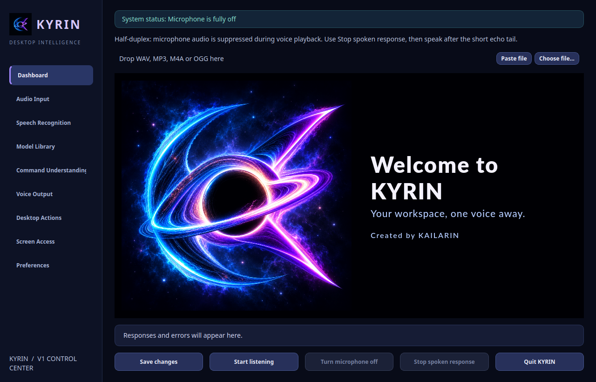
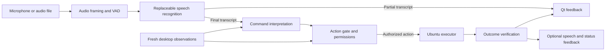

  <picture>
    <source media="(prefers-reduced-motion: reduce)" srcset="assets/brand/hero-still.webp">
    
  </picture>

<h1 align="center">KYRIN</h1>

  A local-first voice desktop agent with permission-gated actions. 
  Built by <a href="https://github.com/mohammadhosseinzakeri10">Mohammad Hossein Zakeri</a> · Kailarin

  
  <a href="LICENSE">MIT license</a> · Python 3.14+ · Ubuntu / GNOME · v0.1.0 alpha

  <a href="#try-it">Try it</a> · <a href="docs/architecture/OVERVIEW.md">Architecture</a> ·
  <a href="docs/README.md">Documentation</a> · <a href="CONTRIBUTING.md">Contributing</a> ·
  <a href="CHANGELOG.md">Changelog</a>

KYRIN turns local speech into bounded desktop commands on Ubuntu/GNOME.
Its speech engines are replaceable, and its command interpreter proposes
actions that a separate authorization layer can reject. The Qt control
center configures audio, models, and desktop permissions.

**v0.1.0 is an MIT-licensed portfolio alpha.** The
[tagged release](https://github.com/mohammadhosseinzakeri10/kyrin/releases/tag/v0.1.0)
includes source and Python build artifacts. Optional runtimes, speech models,
and GNOME integration require separate setup. Later development is planned
for a private repository. See the [release policy](docs/RELEASE_POLICY.md).

## Try it

Use Python 3.14 or later on Linux to open the Qt control center. The desktop
instructions target Ubuntu 26.04 with GNOME Shell 50 on Wayland. Portal
helpers also require the system Python and GObject Introspection bindings.
Follow [Getting started](docs/GETTING_STARTED.md) for the pinned installation,
model setup, and example commands. A fresh configuration opens without
microphone capture or desktop action authority.

The actual Qt control window rendered in an isolated preview with default
settings. The image shows the interface before a model or microphone session.

## Capabilities in v0.1.0

| Area | What this snapshot implements | What to expect |
| --- | --- | --- |
| Speech input | Microphone capture, local-file input, voice activity detection, and Vosk, whisper.cpp, and Omnilingual adapters | Recognition needs a compatible local model and runtime. Start with the documented English examples. |
| Command understanding | Deterministic phrases, optional loopback Ollama proposals, bounded recovery and numbered clarification | Coverage depends on the recognized text, supported action and target. |
| Desktop control | App launch and activation, selected window operations, scrolling and named visible controls | Requires explicit permissions. Accessibility, GNOME extensions, portal consent and OCR requirements vary by operation. |
| Telegram Desktop | Selected navigation, including Saved Messages and guarded chat selection | Coverage depends on the window and readable targets. The chat-opening flow does not send a message. |
| Feedback | Qt output, English/Persian interface, optional local speech output and GNOME status character | Speech output requires its own runtime and model. UI language and recognition language are separate settings. |

See the [supported examples](docs/GETTING_STARTED.md#example-commands) and
[validation and limits](docs/VALIDATION.md). Selected owner observations cover
individual scenarios on one desktop. The deterministic suite covers software
contracts with test doubles and synthetic evidence.

## Architecture at a glance

Local model output can propose a target. The action path independently checks
capability, target identity and operation lifetime. A reported dispatch can
have an unverified effect. See the [architecture](docs/architecture/OVERVIEW.md),
[source map](docs/development/PROJECT_LAYOUT.md), [control policy](docs/actions/CONTROL_POLICY.md)
and [security boundaries](SECURITY.md).

## Development and support

[Contributing](CONTRIBUTING.md) describes the pinned development environment
and how to run the same syntax, Ruff, strict mypy and pytest gate used in CI.
[Validation](docs/VALIDATION.md) records the tagged commit's results separately
from live desktop evidence. The [documentation index](docs/README.md)
distinguishes current guides from historical engineering notes.

Use [issues](https://github.com/mohammadhosseinzakeri10/kyrin/issues) for
reproducible reports about the public snapshot. Follow [SECURITY.md](SECURITY.md)
for private vulnerability reporting and [community conduct](CODE_OF_CONDUCT.md)
for participation expectations.

## License and attribution

KYRIN source is distributed under the [MIT License](LICENSE). The bundled
Silero VAD model retains its own MIT notice. See [third-party notices](THIRD_PARTY_NOTICES.md)
for the boundary between project code, dependencies and separately acquired
models. The project was developed with AI assistance under maintainer direction.
