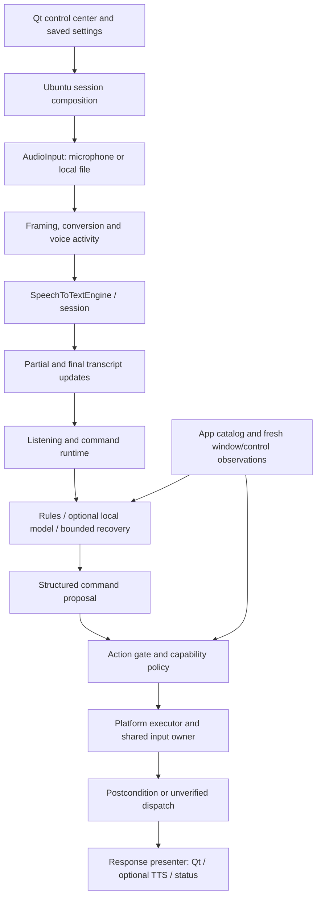

# Current architecture

This describes the implementation in the v0.1.0 public snapshot. The original
[Voice Core requirements](v1-voice-core-analysis.md) document an earlier scope.
The implementation now includes a Qt application and guarded Ubuntu/GNOME
desktop operations as well as audio and recognition.

## Data flow and responsibilities

| Package | Responsibility | Representative code |
| --- | --- | --- |
| `audio` | Raw acquisition, PCM shape, framing, sample conversion and VAD | [AudioInput](../../src/kyrin/audio/audio_input.py), [microphone adapter](../../src/kyrin/audio/microphone/input.py) |
| `stt` | Replaceable recognition contracts, sessions, transcript evidence and engine lifecycle | [contracts](../../src/kyrin/stt/contracts.py), [backends](../../src/kyrin/stt/backends/) |
| `runtime` | Speech-session lifecycle, bounded queues, standby/stop and ordered command delivery | [command runtime](../../src/kyrin/runtime/command_runtime.py), [worker](../../src/kyrin/runtime/command_worker.py) |
| `commands` | Interpretation, entity resolution, clarification and optional model proposals | [coordinator](../../src/kyrin/commands/coordinator.py), [understanding contract](../../src/kyrin/commands/understanding.py) |
| `actions` | Authorization, execution lifecycle, cancellation and platform operations | [gate](../../src/kyrin/actions/gate.py), [policy](../../src/kyrin/actions/control_policy.py), [input sessions](../../src/kyrin/actions/platforms/input_session.py) |
| `desktop`, `vision` | App/window identity, accessibility, capture geometry and OCR contracts | [active app](../../src/kyrin/desktop/active_app.py), [capture geometry](../../src/kyrin/vision/capture_geometry.py) |
| `responses`, `tts` | Outcome presentation and replaceable local speech output | [presenter](../../src/kyrin/responses/presenter.py), [TTS runtime](../../src/kyrin/tts/runtime.py) |
| `app` | Settings, model import, dependency composition and UI | [Ubuntu factory](../../src/kyrin/app/platforms/ubuntu.py), [Qt entry](../../src/kyrin/app/qt/main.py) |
| `memory`, `system_power` | Bounded local transcript history and separately gated power flow | [history](../../src/kyrin/memory/history.py), [power flow](../../src/kyrin/system_power/flow.py) |

## Decisions that define the boundaries

**Acquisition is separate from interpretation.** `MicrophoneInput` acquires
raw audio. Recognition is selected through STT contracts. The live speech
pipeline composes them; microphone construction does not perform language
understanding or desktop actions.

**Partial and final speech have different authority.** Replaceable previews
must not become repeated desktop actions. Final updates enter bounded command
processing; stop, standby or session changes invalidate pending work and late
results. A cooperative cancellation deadline does not imply that any Python
thread can be killed safely.

**Understanding proposes; execution authorizes.** Fast deterministic rules
handle supported phrases. An optional local Ollama model can propose structured
meaning, with source-text and target checks. Recognition alternatives and
bounded recovery can request clarification; they do not grant permissions.
App/capability policy and executable operation support are checked separately.

**Observations expire.** Window tokens, process/app identity, observation
provenance and deadlines travel with action evidence. A new read does not
make an old request valid for a replacement window. Named controls prefer
accessibility semantics; selected OCR paths require their own geometry and
identity evidence. Ambiguity and incomplete reads can reject a request.

**Input ownership has a lifecycle.** A system-Python owner maintains the
portal D-Bus connection and shared input session. Setup/restore is separate
from ordinary command dispatch. Disconnect, revocation and cancellation
invalidate work; a dispatch already in progress cannot always be recalled.
Each request still validates its target and time budget.

**Effects have explicit uncertainty.** Some actions have measurable
postconditions; others can establish only that input was dispatched.
`dispatched_unverified` is not a verified application effect, and an unknown
result does not justify automatic repetition.

**The UI composes components.** Page widgets edit settings. The Ubuntu factory
assembles platform adapters and selected engines. Optional workers isolate
incompatible runtime requirements and permit process lifecycle management;
they are not a universal sandbox. Local model files are data separate from
source and settings.

## Validation and scope

Tests mirror component responsibilities and include synthetic portal/D-Bus,
Qt, permission, cancellation and stale-observation scenarios. They are run by
the same [quality gate](../development/QUALITY_CHECKS.md) locally and in CI.
[Validation notes](../VALIDATION.md) distinguish that evidence from owner live
checks. Cross-platform adapters, a self-contained installer and universal
natural-language desktop control are not part of this release.
